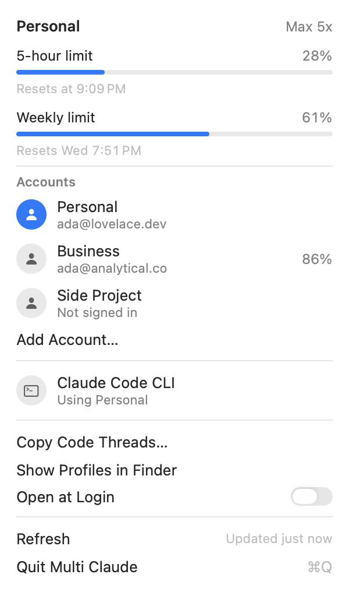

# Multi Claude

A tiny macOS menu bar app for people with more than one Claude account (say, Personal and Business). One click swaps both the Claude desktop app and the `claude` CLI in your terminal between accounts, and a panel shows how much usage each account has left before you pick one.

<p align="center"></p>

## What it does

- **Switch accounts in one click.** Each account keeps its own login, settings and Claude Code threads. No signing out and back in.
- **Terminal follows along.** Switching also moves the `claude` CLI's login, so desktop and terminal are on the same account. The terminal row shows which account the CLI is on and offers to move it if they ever differ.
- **See your limits at a glance.** For every account: how much of the 5-hour and weekly limits you've used (the same numbers as Claude's own usage panel), and when each one resets.
- **Menu bar readout.** The active account's initial sits inside a ring that fills as its 5-hour limit is used, followed by the percentage, e.g. (B) 13%.
- **Add as many accounts as you like.** Click **Add Account…**, give it a name, switch to it and sign in.
- **Bring your Claude Code threads along.** **Copy Code Threads…** opens a window where you pick threads from one account and copy them to another, so you can keep working on a project after switching. Full history comes with them.
- **Open at login.** Flip the **Open at Login** switch in the panel.

## Install

Requires macOS 13+ (Apple Silicon or Intel).

### Download

1. Grab **MultiClaude.dmg** from the [latest release](https://github.com/claynicholson/multi-claude/releases/latest).
2. Open it and drag **Multi Claude** into **Applications**.
3. Open it. The app isn't notarized by Apple, so macOS will block the first launch. Go to **System Settings → Privacy & Security**, scroll down and click **Open Anyway**. (Or run `xattr -dr com.apple.quarantine "/Applications/Multi Claude.app"` in Terminal.)
4. Flip the **Open at Login** switch in the panel if you want it to start with your Mac.

### Build from source

Needs the Xcode Command Line Tools (`xcode-select --install`).

```sh
git clone https://github.com/claynicholson/multi-claude.git
cd multi-claude
./build.sh install
```

That builds the app, copies it to `/Applications`, adds it to Login Items and launches it. Use `./build.sh` on its own to just build it in place, or `./build.sh dmg` to package a universal `dist/MultiClaude.dmg`.

The first time it reads usage, macOS asks whether **Multi Claude** may access **Claude Safe Storage** in your keychain. Click **Always Allow** (see [How usage works](#how-usage-works) for why).

## How switching works

Claude Desktop keeps everything (login, cookies, threads) in `~/Library/Application Support/Claude`. Multi Claude keeps the inactive accounts next to it:

```
~/Library/Application Support/
├── Claude/                 ← whichever account is active
└── Claude-Profiles/
    ├── Business/           ← parked accounts
    ├── .current            ← name of the active one
    └── .cache/             ← last-known usage per account
```

Switching quits Claude, renames the folders (instant, even for many GB) and reopens Claude. A new account starts as an empty folder, so Claude opens signed out and you log in once.

Safety rails: if Claude doesn't quit within 15 seconds, nothing is moved. It never overwrites a parked profile that has data in it.

## How the terminal switch works

The `claude` CLI keeps its login in two places: the keychain item **Claude Code-credentials** (the `claudeAiOauth` entry) and `oauthAccount` in `~/.claude.json`. When you switch, Claude Switcher:

1. Saves the terminal's current login to its own keychain item (**Claude Switcher**, one entry per profile; the name is kept from earlier versions).
2. Puts the target profile's saved login in its place. If that profile has never been used in the terminal, the CLI is logged out instead: run `claude /login` once with that account and it's remembered from then on.

Only the Claude login moves. MCP server logins (Figma, Notion, Linear…) stored in the same keychain item stay put and are shared by every profile, as are your projects and history in `~/.claude`.

**Restart running `claude` sessions after switching.** A session that was already open keeps using the old account and may save its login back. Before filing a login away, the switcher checks that it really belongs to the profile you're leaving, and stops with a warning if not.

## How copying threads works

Each Claude Code thread in the desktop app is a small JSON file in `claude-code-sessions/<account>/<org>/` inside the profile. The conversation itself lives in `~/.claude/projects`, which every account shares, so copying that JSON file is enough for the other account to resume the thread. A few account-specific fields (connectors, remote-control links, armed scheduled tasks) are stripped on copy. Threads that already exist in the destination are skipped, and nothing is deleted from the source.

If the destination is the active account, Claude restarts so the new threads show up. The destination account must have opened the Code tab at least once.

## How usage works

Claude Desktop stores each account's login token in that account's `config.json`, encrypted with a key in your macOS keychain. Multi Claude decrypts the token locally and calls the same usage endpoint the Claude apps use (`api.anthropic.com/api/oauth/usage`). Tokens never leave your Mac except in requests to `api.anthropic.com`. Usage refreshes when you open the panel and every 5 minutes.

## Caveats

- **Unofficial.** This isn't made by or affiliated with Anthropic. The usage endpoint is undocumented and could change; if it does, cards fall back to the last known numbers ("as of 2h ago").
- **Terminal sessions don't switch mid-flight.** Open `claude` sessions stay on the old account until restarted.
- **Switching quits Claude.** Let running sessions finish first.
- Claude Code transcripts live in the shared `~/.claude/projects`. Only the desktop thread lists are split per account, which is what makes copying threads possible.
- The app is ad-hoc signed, so after rebuilding you'll get the keychain prompt again.

## Uninstall

Turn off **Open at Login**, click **Quit** in the panel (or press ⌘Q while it's open), then delete `/Applications/Multi Claude.app`. Saved terminal logins live in Keychain Access under **Claude Switcher** and can be deleted there. To merge back to one account, switch to the one you want to keep and delete `~/Library/Application Support/Claude-Profiles`.

## Development

The code is in [`Sources/`](Sources) (SwiftUI in an `NSPopover`, no Xcode project): `Core.swift` has profiles, switching, the keychain and usage fetching; `Panel.swift` is the menu bar panel; `CopyThreads.swift` is the thread copier; `StatusIcon.swift` draws the menu bar icon; `main.swift` starts the app. The app icon is drawn by [`tools/make-icon.swift`](tools/make-icon.swift) into `Resources/AppIcon.icns` (run `swift tools/make-icon.swift` after changing it). The panel is styled like the system menu bar extras (Wi-Fi, Battery) and uses the system accent color, so it follows light/dark mode and your accent setting. To regenerate the screenshot with fake data:

```sh
./build.sh && "./Multi Claude.app/Contents/MacOS/MultiClaude" --snapshot docs/panel.png --demo   # add --dark for dark mode
```

## Credits

Multi Claude started as a fork of [l2succes/claude-switcher](https://github.com/l2succes/claude-switcher) by Luc Succes, which did the hard parts: switching Claude Desktop profiles, decrypting each account's token for usage, and moving the CLI login. This version has a new native interface, a live menu bar gauge and its own icon.

## License

MIT
