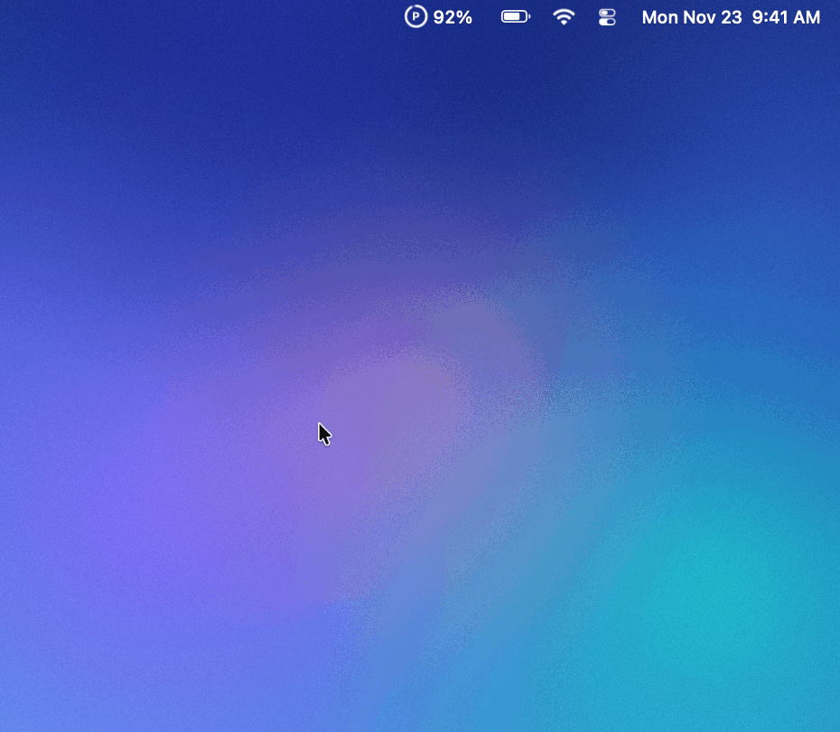

# Multi Claude

Got more than one Claude account? Switch between them from the menu bar in one click, and see how much of each account's limit you've used before you pick one.

- **One click** swaps the Claude desktop app and the `claude` CLI together.
- **Usage at a glance:** 5-hour and weekly limits for every account, right in the menu bar.
- **Nothing to set up:** each account keeps its own login, settings and threads.

## Get it

**[Download Multi Claude](https://github.com/claynicholson/multi-claude/releases/latest)**, open the DMG and drag it to Applications. Requires macOS 13 or later.

The app isn't notarized yet, so the first time you open it, go to **System Settings → Privacy & Security** and click **Open Anyway**.

Prefer to build it yourself? `git clone` this repo and run `./build.sh install`.

---

Based on [claude-switcher](https://github.com/l2succes/claude-switcher) by Luc Succes. MIT licensed.
